# DataInsight AI – CSV Dataset Insight & Task Recommender (P10)

DataInsight AI is a Streamlit CSV analysis and Generative AI learning application. It combines deterministic pandas profiling and querying with optional Groq-powered text and consent-gated vision features, selectable BERT-tiny column embeddings, a custom educational GAN and SDV's CTGAN implementation, image/audio utilities, and responsible-AI screening.

---

## Architecture Overview

```mermaid
graph TD
    A["CSV Upload / Public Benchmark"] --> B["Data Profiling Engine"]
    B --> C["Type Identification & Missing Analysis"]
    B --> D["Plotly Interactive Visualizations"]
    B --> E["ML Task Recommender (Classification/Regression/Clustering)"]
    
    A --> F["High-Performance Chat Engine"]
    F -->|Instant Pattern Match| G["Fast-Path Pandas Execution (<10ms)"]
    F -->|Complex Query| H["Groq Single-Call Structured Planner"]
    H --> G
    G --> I["Deterministic Natural-Language Explanation"]
    
    A --> J["U1 & U2: Foundations & Architectures"]
    J --> J1["Generative vs Discriminative Modeling"]
    J --> J2["Prompt Engineering Studio & Sampling Explorer"]
    J --> J3["LoRA PEFT Calculator & Attention Visualizer"]
    
    A --> K["U3: BERT & Multimodal Studio"]
    K --> K1["BERT-tiny or TF-IDF Column Clustering"]
    K --> K2["GPT Narrative Insight Generator"]
    K --> K3["Audio Narration (pyttsx3) & Dataset Cards"]
    K --> K4["Opt-in Groq Vision Chart Image Analysis"]
    
    A --> L["U4: Custom GAN or SDV CTGAN Synthesis"]
    L --> L1["Explicit backend choice; PyTorch custom GAN or SDV CTGAN"]
    L --> L2["Kolmogorov-Smirnov & Correlation Validation"]
    
    A --> M["U5: Responsible AI & Model Card"]
    M --> M1["Sensitive-Column & PII Detection"]
    M --> M2["Class Imbalance Entropy & Demographic Fairness"]
    M --> M3["Hallucination Verification & Model Card Export"]
```



---

## Assignment Requirements Coverage (U1 to U5)

| Syllabus Unit | Requirement | Implementation Module |
| :--- | :--- | :--- |
| **U1 – Foundations of GenAI** | Dataset distributions & visualizations | `modules/visualization.py` (Histogram, Boxplot, Bar, Scatter, Violin, Heatmap) |
| | ML task recommendations | `modules/recommender.py` (Classification, Regression, Clustering) |
| | Learning-type identification & lifecycle | `modules/gen_vs_disc.py` (Supervised, Unsupervised, Self-Supervised, Generative) |
| | Generative vs Discriminative learning | `modules/gen_vs_disc.py` ($P(Y \mid X)$ vs $P(X, Y)$ mathematical comparison) |
| | Prompt engineering & latent-space sampling | `modules/prompt_engineering.py` (Zero-shot, Few-shot, CoT, Role, Schema, Temperature/Top-p) |
| **U2 – GANs and LLMs** | Transformer-based LLM | `modules/csv_chat.py` (Groq chat completions, optional API key) |
| | Natural-language CSV analysis using pandas | `modules/csv_chat.py` (Fast-Path Pandas + Structured JSON Execution) |
| | Fine-tuning vs prompt-based learning | `modules/finetune_vs_prompt.py` (Radar trade-offs + LoRA parameter calculator) |
| | GAN/VAE or attention explanation | `modules/attention_explainer.py` (Interactive attention weights + Minimax/ELBO comparison) |
| **U3 – GPT, BERT & Multimodal** | GPT-style generator | `modules/gpt_generator.py` (Autoregressive narrative storytelling) |
| | BERT-family embeddings to group columns | `modules/column_embeddings.py` (BERT-tiny contextual embeddings; lexical TF-IDF offline baseline) |
| | Image/chart understanding | `modules/multimodal.py` (consent-gated Groq vision chart-image analysis) |
| | Image and audio output | `modules/multimodal.py` (dataset infographic and local text-to-speech) |
| **U4 – Tools & Generation** | Python with PyTorch | `modules/synthetic_data.py` (custom model uses PyTorch; SDV backend uses SDV/CTGAN) |
| | Conditional tabular synthetic data generation | `modules/synthetic_data.py` (Custom PyTorch GAN, CTGAN-inspired and not canonical; or SDV `CTGANSynthesizer`, the actual CTGAN implementation) |
| | Compare real and synthetic datasets | `modules/synthetic_data.py` (numeric KS tests and correlation comparison; unavailable metrics are not fabricated) |
| | Address image/video/music generation | `modules/multimodal.py` (dataset infographic image, local speech TTS and Groq chart-image understanding; no text-to-image, video or music generator) |
| **U5 – Responsible AI** | Sensitive-column & PII detection | `modules/responsible_ai.py` (Regex PII detection + Protected attribute audit) |
| | Class-imbalance detection | `modules/responsible_ai.py` (Shannon entropy, ratio metrics, SMOTE recommendations) |
| | Bias & hallucination evaluation | `modules/responsible_ai.py` (selectable positive-outcome fairness screening + heuristic numeric grounding) |
| | Safety guardrails | `modules/csv_chat.py` (Zero unrestricted `eval()`/`exec()`, strict operation whitelist) |
| | Licence/IP considerations | `modules/responsible_ai.py` (CC0, CC-BY, MIT, ODC-By, CC-BY-NC guidance) |
| | Model card | `MODEL_CARD.md` & `modules/responsible_ai.py` (Mitchell et al. 2019 standard) |

---

## Chat Execution and Guardrails

- **Local fast path:** Clear row-count, aggregation, distribution, grouped-aggregation, and correlation questions are answered with pandas without an API call.
- **Complex queries:** If configured, Groq receives the question and column metadata and returns a validated restricted JSON operation plan. Pandas Code mode also offers a strict AST-validated interpreter; generated expressions are interpreted without `eval()` or `exec()`.
- **Local processing:** Deterministic queries remain in local pandas. Unsupported or failed requests are reported instead of being replaced with a different result.
- **API use:** Text defaults to `openai/gpt-oss-20b`; image analysis defaults to `qwen/qwen3.8-27b` and is requested only after explicit image consent. The cached Groq client disables automatic retries. Actual availability depends on model access, network, and provider quota.
- **Inspection:** Optional chat metadata shows the selected operation and the pandas expression used.

---

## Bundled Curated Datasets and Attribution

The original sample datasets remain in the repository root (`sample_customers.csv`,
`sample_healthcare.csv`, and `sample_housing.csv`). Four additional public datasets
are bundled under `datasets/` and are selected separately in the app. They are read
from local files at runtime; the app does not download them on startup.

| Dataset | Bundled file | Source and citation | License |
| --- | --- | --- | --- |
| Adult Census Income | `datasets/adult_census_income.csv` | Barry Becker and Ronny Kohavi (1996), [UCI Adult](https://archive.ics.uci.edu/dataset/2/adult), DOI [10.24432/C5XW20](https://doi.org/10.24432/C5XW20) | CC BY 4.0 |
| Palmer Penguins | `datasets/palmer_penguins.csv` | Allison Horst, Alison Hill, and Kristen Gorman (2020), [palmerpenguins v0.1.0](https://doi.org/10.5281/zenodo.3960218); data collected by Kristen Gorman and Palmer Station LTER | CC0 |
| Wine Quality Red | `datasets/wine_quality_red.csv` | Paulo Cortez, A. Cerdeira, F. Almeida, T. Matos, and J. Reis (2009), [UCI Wine Quality](https://archive.ics.uci.edu/dataset/186/wine+quality), DOI [10.24432/C56S3T](https://doi.org/10.24432/C56S3T) | CC BY 4.0 |
| Wine Quality White | `datasets/wine_quality_white.csv` | Paulo Cortez, A. Cerdeira, F. Almeida, T. Matos, and J. Reis (2009), [UCI Wine Quality](https://archive.ics.uci.edu/dataset/186/wine+quality), DOI [10.24432/C56S3T](https://doi.org/10.24432/C56S3T) | CC BY 4.0 |

Adult CSV loading trims whitespace, converts `?` markers to missing values, and
normalizes income labels such as `>50K.` to `>50K`. Palmer Penguins missing values
and all categorical labels are preserved. Wine files are parsed with their
semicolon delimiter. None of the loaders imputes or drops rows. The selected
dataset's source, citation, and license are shown in the sidebar.

---

## Reproducible Evaluation Snapshot

The [evaluation_results.json](./evaluation_results.json) file is produced
by `python scripts/evaluate_project.py`. It records the actual four-dataset
column-type comparison, a fresh seeded Palmer Penguins run of both GAN backends,
historical external-provider request outcomes, and the local dependency versions.
The results and metric definitions are detailed in [REPORTS.md](./REPORTS.md).
The older Palmer Penguins figures (Custom GAN 56.4% / 79.9%; SDV CTGAN
68.0% / 78.7%) were supplied as prior experiment results; their original run
configuration was unavailable, so they are retained as historical references,
not presented as independently reproduced measurements.

| Column-type test | Correct | Accuracy |
|---|---:|---:|
| Adult Census Income | 15/15 | 100% |
| Palmer Penguins | 8/8 | 100% |
| Wine Quality Red | 12/12 | 100% |
| Wine Quality White | 12/12 | 100% |
| **Overall** | **47/47** | **100%** |

Fresh Palmer Penguins CPU evaluation (344 generated rows per backend):

| Backend | Epochs | Fit time | Distribution similarity | Correlation similarity |
|---|---:|---:|---:|---:|
| Custom PyTorch GAN (not canonical CTGAN) | 30 | 26.302 s | 88.6% | 96.4% |
| SDV CTGAN (`CTGANSynthesizer`) | 50 | 14.390 s | 76.0% | 80.9% |

The historical external-provider latency measurement made five direct planner
requests. All five failed (3 server errors, 2 client errors); successful
response count is 0 and mean successful latency is **not available**. Failure
times are preserved in `evaluation_results.json`, not mislabeled as successful
response times. These records predate the current Groq integration and do not
verify current Groq text or vision availability.

Column types are assessed as stored analytical types, not semantic task roles:
for example, wine `quality` is evaluated as numerical because it is stored as
an integer-valued numeric column. GAN similarity is measured on non-identifier
numeric columns only and is not a privacy or anonymity metric.

The evaluation identified and fixed an identifier false positive: `citric acid`
was mistakenly classified as an ID by the old suffix-only rule. Identifier
names now use tokens, and the profiler test protects this case.

### Multimodal implementation status

- **Implemented:** static dataset infographic PNG generation; optional
  consent-gated Groq chart-image understanding; local speech synthesis that
  reads text aloud.
- **Not implemented:** prompt-to-image generation, video generation, or music
  generation. The app's cross-modal survey is educational content, not a
  generation tool. Text-to-speech is not music/audio-content generation.

### Known verified failure case

The deployed histogram once failed at `px.histogram(...)` with
`ValueError: Invalid value` (reported Streamlit log: `app.py` called
`create_histogram`). The project pins Plotly 5.24.1, and the histogram tests
exercise Plotly figure creation against that installed version. See
[REPORTS.md](./REPORTS.md) for the observation, fix and test evidence. This
documents local verification, not a claim that a remote deployment was tested.

---

## Installation & Local Execution

### Prerequisites
- Windows 11, macOS, or Linux
- Python 3.11
- 16 GB RAM (runs on CPU / integrated graphics)
- CSV uploads are limited to 50 MB by default for resource safety.

### Step 1: Clone Repository & Setup Virtual Environment
```bash
git clone https://github.com/your-username/DataInsightAI.git
cd DataInsightAI
python -m venv .venv
# Windows:
.\.venv\Scripts\activate
# Linux/macOS:
source .venv/bin/activate
```

### Step 2: Install Dependencies
```bash
pip install -r requirements.txt
```

### Step 3: Configure Environment Variables
Create a `.env` file in the root folder (or use the matching Streamlit Secret):
```env
GROQ_API_KEY=your_groq_api_key_here
GROQ_TEXT_MODEL=openai/gpt-oss-20b
GROQ_VISION_MODEL=qwen/qwen3.8-27b
```
Obtain a key from [Groq Console](https://console.groq.com/keys). Keep it in an
environment variable or platform secret; do not commit `.env`. The client
defaults to `openai/gpt-oss-20b` for text and `qwen/qwen3.8-27b` for vision;
the model environment variables shown above can override these defaults. The key
is optional for local profiling, the lexical column baseline, and deterministic
local dataset analysis. Groq-backed complex chat, narrative output, and
chart-image understanding need a key. Chart-image analysis requires explicit
consent for the selected image.

### Step 4: Run the Application
```bash
streamlit run app.py
```

### Step 5: Run Automated Tests
```bash
python -m pytest tests/
```
The test command reports the current result for the checked-out environment.

---

## Deployment to Hugging Face Spaces

1. Create a new Space on [Hugging Face Spaces](https://huggingface.co/spaces).
2. Choose **Streamlit** as the SDK.
3. Push your repository files (`app.py`, `modules/`, `requirements.txt`, `packages.txt`, `datasets/`, `sample_*.csv`, `MODEL_CARD.md`).
4. In the Space settings, add your **Repository Secret**:
   - Variable name: `GROQ_API_KEY`
   - Value: your Groq API key
5. Local dependency and application checks have been run, but no Streamlit
Community Cloud or Hugging Face Spaces deployment has been verified. Both
platforms build from the root `requirements.txt`; the SDV/PyTorch dependency
set may increase build time and memory use. `packages.txt` requests `espeak`
for Linux text-to-speech and should be confirmed in the target build. Groq is
optional; add `GROQ_API_KEY` as a platform secret to enable Groq-backed
features. BERT-tiny weights are downloaded when that mode is selected. Video
and music generation are not included. Resolve the SDV BSL public-service
restriction before enabling public SDV synthesis.

---

## Viva Voce Preparation Guide

### 1. What is the fundamental difference between Discriminative and Generative models?
- **Discriminative models** estimate the conditional probability $P(Y \mid X)$ directly. They learn the decision boundary separating classes (e.g. Logistic Regression, Random Forest, SVM) or predict continuous targets (Linear Regression).
- **Generative models** estimate the joint distribution $P(X, Y) = P(X \mid Y)P(Y)$ or data distribution $P(X)$. They model how the data was generated and can synthesize novel samples (e.g. Naive Bayes, CTGAN, VAEs, Diffusion).

### 2. How does this project generate synthetic tabular data?
The synthetic-data tab offers two explicit backends. **Custom PyTorch GAN** is the original compact educational implementation with one-hot categorical features and category-conditioning vectors; it is CTGAN-inspired, not canonical CTGAN, and does not implement mode-specific normalization or the complete CTGAN training objective. **SDV CTGAN** uses SDV's actual `CTGANSynthesizer`. Both train on the currently selected dataset, support a user-selected epoch count, and generate the requested number of rows. The app warns and requires confirmation before training on datasets larger than 5,000 rows. Neither backend provides differential privacy; generated data must not be assumed private or anonymous.

SDV CTGAN runs on CPU with verbose training output disabled. Missing values are passed through to SDV; columns that are entirely missing are rejected with an explicit error rather than dropped. The SDV dependency is distributed under Business Source License 1.1; review its terms for your intended deployment.

**Public service license warning:** SDV 1.28.0's BSL-1.1 license explicitly
excludes a "Synthetic Data Service" from its additional production-use grant.
Because this app exposes synthetic-data generation to users, obtain appropriate
licensing guidance before publicly operating that feature; otherwise disable or
remove the SDV backend in the deployed service. A local dependency/import check
is not a deployment or license approval.

### 3. What is Low-Rank Adaptation (LoRA) and how does it reduce memory?
Instead of updating all weights $W_0 \in \mathbb{R}^{d \times k}$, LoRA freezes $W_0$ and injects trainable rank-decomposition matrices: $\Delta W = \frac{\alpha}{r} (B \cdot A)$ where $A \in \mathbb{R}^{r \times k}$ and $B \in \mathbb{R}^{d \times r}$ with rank $r \ll \min(d, k)$. For a 7B parameter LLM with rank $r=16$, LoRA trains less than 0.1% of weights, cutting GPU memory requirements by over 70%.

### 4. How does Scaled Dot-Product Attention work?
$$\text{Attention}(Q, K, V) = \text{Softmax}\left(\frac{Q K^T}{\sqrt{d_k}}\right) V$$
Queries ($Q$) and Keys ($K$) measure pairwise compatibility scores. Dividing by $\sqrt{d_k}$ prevents dot products from growing excessively large in high dimensions (which would cause vanishing gradients in softmax). Softmax yields non-negative attention weights summing to 1.0, which weight the Values ($V$).

### 5. What are the key Responsible AI considerations implemented in DataInsight AI?
- **Sensitive Feature Detection:** Identifies PII (email, phone, national IDs) and protected classes (gender, age, race).
- **Class Imbalance Mitigation:** Computes Shannon entropy and majority-to-minority ratios, guiding the user toward SMOTE, class-weighted loss, or focal loss.
- **Demographic Fairness:** Evaluates Disparate Impact Ratio (DIR) across sensitive demographic slices using the EEOC 80% (4/5ths) rule.
- **Hallucination Auditing:** A heuristic compares extracted numeric claims against sample values and statistics; it can miss errors and is not a factuality guarantee.
- **Standardized Model Card:** Exports a complete Mitchell et al. (2019) compliance document.

---

## Deliverables & Artifacts Included
- `app.py`: Streamlit application with tabbed interface.
- `modules/`: reusable modules for profiling, visualization, recommender, chat, GenAI, embeddings, synthesis, multimodal features, and Responsible AI.
- `tests/`: focused test suites for application modules; run them locally to see the current result.
- `MODEL_CARD.md`: Mitchell et al. compliant documentation.
- `REPORTS.md`: Experimental benchmark reports on 3 public datasets with failure case analysis.
- `DEMO_SCRIPT.md`: Timed 2-3 minute demonstration video script.
- `requirements.txt`: Clean cross-platform dependency specifications.

---
*Developed as part of the Final-Year Generative AI Curriculum (P10).*
