# DataInsight AI – CSV Dataset Insight & Task Recommender (P10)

DataInsight AI is a Streamlit CSV analysis and Generative AI learning application. It combines deterministic pandas profiling and querying with an opt-in Gemini assistant, a selectable BERT-tiny column embedding mode, a lightweight conditional GAN, image/audio utilities, and responsible-AI screening.

---

## Architecture Overview

```mermaid
graph TD
    A["CSV Upload / Public Benchmark"] --> B["Data Profiling Engine"]
    B --> C["Type Identification & Missing Analysis"]
    B --> D["Plotly Interactive Visualizations"]
    B --> E["ML Task Recommender (Classification/Regression/Clustering)"]
    
    A --> F["High-Performance Chat Engine"]
    F -->|Instant Pattern Match| G["Fast-Path Pandas Execution (<10ms)"]
    F -->|Complex Query| H["Gemini Single-Call Structured Planner"]
    H --> G
    G --> I["Deterministic Natural-Language Explanation"]
    
    A --> J["U1 & U2: Foundations & Architectures"]
    J --> J1["Generative vs Discriminative Modeling"]
    J --> J2["Prompt Engineering Studio & Sampling Explorer"]
    J --> J3["LoRA PEFT Calculator & Attention Visualizer"]
    
    A --> K["U3: BERT & Multimodal Studio"]
    K --> K1["BERT-tiny or TF-IDF Column Clustering"]
    K --> K2["GPT Narrative Insight Generator"]
    K --> K3["Audio Narration (pyttsx3) & Dataset Cards"]
    K --> K4["Opt-in Gemini Chart Image Analysis"]
    
    A --> L["U4: PyTorch Conditional GAN Synthesis"]
    L --> L1["One-hot Categories & Conditional Generator"]
    L --> L2["Kolmogorov-Smirnov & Correlation Validation"]
    
    A --> M["U5: Responsible AI & Model Card"]
    M --> M1["Sensitive-Column & PII Detection"]
    M --> M2["Class Imbalance Entropy & Demographic Fairness"]
    M --> M3["Hallucination Verification & Model Card Export"]
```



---

## Assignment Requirements Coverage (U1 to U5)

| Syllabus Unit | Requirement | Implementation Module |
| :--- | :--- | :--- |
| **U1 – Foundations of GenAI** | Dataset distributions & visualizations | `modules/visualization.py` (Histogram, Boxplot, Bar, Scatter, Violin, Heatmap) |
| | ML task recommendations | `modules/recommender.py` (Classification, Regression, Clustering) |
| | Learning-type identification & lifecycle | `modules/gen_vs_disc.py` (Supervised, Unsupervised, Self-Supervised, Generative) |
| | Generative vs Discriminative learning | `modules/gen_vs_disc.py` ($P(Y \mid X)$ vs $P(X, Y)$ mathematical comparison) |
| | Prompt engineering & latent-space sampling | `modules/prompt_engineering.py` (Zero-shot, Few-shot, CoT, Role, Schema, Temperature/Top-p) |
| **U2 – GANs and LLMs** | Transformer-based LLM | `modules/csv_chat.py` (Gemini 3.8 Flash, optional API key) |
| | Natural-language CSV analysis using pandas | `modules/csv_chat.py` (Fast-Path Pandas + Structured JSON Execution) |
| | Fine-tuning vs prompt-based learning | `modules/finetune_vs_prompt.py` (Radar trade-offs + LoRA parameter calculator) |
| | GAN/VAE or attention explanation | `modules/attention_explainer.py` (Interactive attention weights + Minimax/ELBO comparison) |
| **U3 – GPT, BERT & Multimodal** | GPT-style generator | `modules/gpt_generator.py` (Autoregressive narrative storytelling) |
| | BERT-family embeddings to group columns | `modules/column_embeddings.py` (BERT-tiny contextual embeddings; lexical TF-IDF offline baseline) |
| | Image/chart understanding | `modules/multimodal.py` (consent-gated Gemini chart-image analysis) |
| | Image and audio output | `modules/multimodal.py` (dataset infographic and local text-to-speech) |
| **U4 – Tools & Generation** | Python with PyTorch | `modules/synthetic_data.py` (PyTorch neural networks) |
| | Conditional tabular synthetic data generation | `modules/synthetic_data.py` (lightweight PyTorch conditional GAN; CTGAN-inspired, not canonical CTGAN) |
| | Compare real and synthetic datasets | `modules/synthetic_data.py` (numeric KS tests and correlation comparison; unavailable metrics are not fabricated) |
| | Address image/video/music generation | `modules/multimodal.py` (image/audio features plus conceptual video/music survey; no video or music generator) |
| **U5 – Responsible AI** | Sensitive-column & PII detection | `modules/responsible_ai.py` (Regex PII detection + Protected attribute audit) |
| | Class-imbalance detection | `modules/responsible_ai.py` (Shannon entropy, ratio metrics, SMOTE recommendations) |
| | Bias & hallucination evaluation | `modules/responsible_ai.py` (selectable positive-outcome fairness screening + heuristic numeric grounding) |
| | Safety guardrails | `modules/csv_chat.py` (Zero unrestricted `eval()`/`exec()`, strict operation whitelist) |
| | Licence/IP considerations | `modules/responsible_ai.py` (CC0, CC-BY, MIT, ODC-By, CC-BY-NC guidance) |
| | Model card | `MODEL_CARD.md` & `modules/responsible_ai.py` (Mitchell et al. 2019 standard) |

---

## Chat Execution and Guardrails

- **Local fast path:** Clear row-count, aggregation, distribution, grouped-aggregation, and correlation questions are answered with pandas without an API call.
- **Complex queries:** If configured, Gemini receives the question and column metadata and returns a restricted JSON operation plan; pandas executes only operations on the explicit whitelist.
- **No generated code execution:** The app does not execute LLM-produced Python. Unsupported or failed requests are reported instead of being replaced with a fabricated count.
- **API use:** A cached Gemini client uses bounded retries. Actual latency depends on the network, provider quota, and selected dataset; no fixed latency is guaranteed.
- **Inspection:** Optional chat metadata shows the selected operation and the pandas expression used.

---

## Installation & Local Execution

### Prerequisites
- Windows 11, macOS, or Linux
- Python 3.11
- 16 GB RAM (runs on CPU / integrated graphics)
- CSV uploads are limited to 50 MB by default for resource safety.

### Step 1: Clone Repository & Setup Virtual Environment
```bash
git clone https://github.com/your-username/DataInsightAI.git
cd DataInsightAI
python -m venv .venv
# Windows:
.\.venv\Scripts\activate
# Linux/macOS:
source .venv/bin/activate
```

### Step 2: Install Dependencies
```bash
pip install -r requirements.txt
```

### Step 3: Configure Environment Variables
Create a `.env` file in the root folder:
```env
GEMINI_API_KEY=your_gemini_api_key_here
```
*(You can obtain a free API key from [Google AI Studio](https://aistudio.google.com/)).*
The key is optional for local profiling, the lexical column baseline, and local dataset analysis. Gemini-backed question planning, narrative output, and chart-image understanding need a key. Chart-image analysis requires a separate explicit consent for each selected image.

### Step 4: Run the Application
```bash
streamlit run app.py
```

### Step 5: Run Automated Tests
```bash
python -m pytest tests/
```
The test command reports the current result for the checked-out environment.

---

## Deployment to Hugging Face Spaces

1. Create a new Space on [Hugging Face Spaces](https://huggingface.co/spaces).
2. Choose **Streamlit** as the SDK.
3. Push your repository files (`app.py`, `modules/`, `requirements.txt`, `packages.txt`, `sample_*.csv`, `MODEL_CARD.md`).
4. In the Space settings, add your **Repository Secret**:
   - Variable name: `GEMINI_API_KEY`
   - Value: `your_gemini_api_key_here`
5. The application can run on a CPU Space. Gemini is optional; add `GEMINI_API_KEY` as a Space secret to enable Gemini chat, narrative generation, and consent-gated chart analysis. BERT-tiny weights are downloaded from Hugging Face when that embedding mode is selected. Video and music generation are not included; their architectures are covered in the curriculum survey.

---

## Viva Voce Preparation Guide

### 1. What is the fundamental difference between Discriminative and Generative models?
- **Discriminative models** estimate the conditional probability $P(Y \mid X)$ directly. They learn the decision boundary separating classes (e.g. Logistic Regression, Random Forest, SVM) or predict continuous targets (Linear Regression).
- **Generative models** estimate the joint distribution $P(X, Y) = P(X \mid Y)P(Y)$ or data distribution $P(X)$. They model how the data was generated and can synthesize novel samples (e.g. Naive Bayes, CTGAN, VAEs, Diffusion).

### 2. How does this project generate synthetic tabular data?
The project implements a compact conditional GAN demonstration with one-hot categorical features and category-conditioning vectors. It is **CTGAN-inspired, not the canonical CTGAN**: it does not implement mode-specific normalization or the complete CTGAN training objective. It is intended for coursework, not privacy-preserving release. No differential privacy guarantee is provided.

### 3. What is Low-Rank Adaptation (LoRA) and how does it reduce memory?
Instead of updating all weights $W_0 \in \mathbb{R}^{d \times k}$, LoRA freezes $W_0$ and injects trainable rank-decomposition matrices: $\Delta W = \frac{\alpha}{r} (B \cdot A)$ where $A \in \mathbb{R}^{r \times k}$ and $B \in \mathbb{R}^{d \times r}$ with rank $r \ll \min(d, k)$. For a 7B parameter LLM with rank $r=16$, LoRA trains less than 0.1% of weights, cutting GPU memory requirements by over 70%.

### 4. How does Scaled Dot-Product Attention work?
$$\text{Attention}(Q, K, V) = \text{Softmax}\left(\frac{Q K^T}{\sqrt{d_k}}\right) V$$
Queries ($Q$) and Keys ($K$) measure pairwise compatibility scores. Dividing by $\sqrt{d_k}$ prevents dot products from growing excessively large in high dimensions (which would cause vanishing gradients in softmax). Softmax yields non-negative attention weights summing to 1.0, which weight the Values ($V$).

### 5. What are the key Responsible AI considerations implemented in DataInsight AI?
- **Sensitive Feature Detection:** Identifies PII (email, phone, national IDs) and protected classes (gender, age, race).
- **Class Imbalance Mitigation:** Computes Shannon entropy and majority-to-minority ratios, guiding the user toward SMOTE, class-weighted loss, or focal loss.
- **Demographic Fairness:** Evaluates Disparate Impact Ratio (DIR) across sensitive demographic slices using the EEOC 80% (4/5ths) rule.
- **Hallucination Auditing:** A heuristic compares extracted numeric claims against sample values and statistics; it can miss errors and is not a factuality guarantee.
- **Standardized Model Card:** Exports a complete Mitchell et al. (2019) compliance document.

---

## Deliverables & Artifacts Included
- `app.py`: Streamlit application with tabbed interface.
- `modules/`: reusable modules for profiling, visualization, recommender, chat, GenAI, embeddings, synthesis, multimodal features, and Responsible AI.
- `tests/`: focused test suites for application modules; run them locally to see the current result.
- `MODEL_CARD.md`: Mitchell et al. compliant documentation.
- `REPORTS.md`: Experimental benchmark reports on 3 public datasets with failure case analysis.
- `DEMO_SCRIPT.md`: Timed 2-3 minute demonstration video script.
- `requirements.txt`: Clean cross-platform dependency specifications.

---
*Developed as part of the Final-Year Generative AI Curriculum (P10).*
